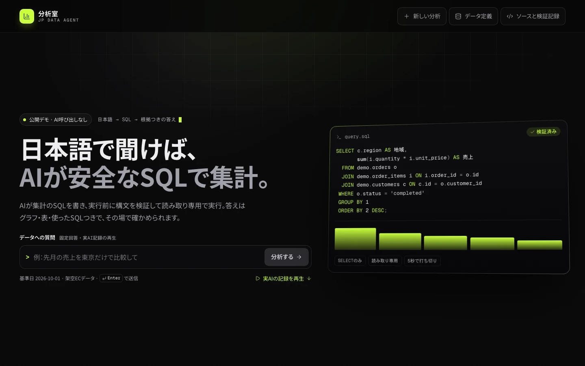
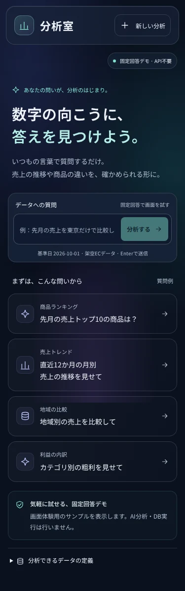

# UI・UXの設計方針

2026-10-11にUIをグラスモーフィズムへ改修しました。参照したのは [UI UX Pro Max](https://github.com/nextlevelbuilder/ui-ux-pro-max-skill/tree/67803eac81607188194aea9842a723b89326d90d) の公式スキル、Glassmorphismスタイル、analytics dashboardのデザインシステム、フォーカスとNext.jsのガイドです。参照元のスキルやCLIを本アプリへ組み込んでいるわけではありません。

## デザイン

濃紺の背景にミントと青紫の光を重ね、18pxの背景ぼかし、半透明の面、細い境界線で階層を作っています。本文と集計結果の読みやすさを優先し、文字・背景・境界・操作色をCSSの共通トークンで管理します。日本語フォントはアプリに同梱したNoto Sans JPを使用します。ヒーローの図形は装飾であり、実際の分析数値ではありません。

## 操作

- 初回は質問入力と4つの質問例を表示。分析結果へフォーカスを移し、スクロールします。
- 入力欄は文書内に配置し、結果・質問例・キーボードフォーカスを覆いません。
- 通信失敗時は入力を保持し、再試行できます。処理中は二重送信を防ぎ、停止できます。
- 新しい分析で画面上の結果と会話をリセットし、質問欄へフォーカスします。
- 集計表・SQL・実行情報は段階的に開示。集計表はキーボードでもスクロールできます。
- SQLコピーの成功表示は操作した結果だけに表示し、クリップボード拒否時は説明します。
- 固定回答デモと実AIを明示。デモをAIの精度・費用・速度の証拠として扱いません。

## アクセシビリティと検証

可視ラベル、スキップリンク、明確なフォーカスリング、44px以上の主要操作領域、動きを減らす設定、ぼかし非対応時の不透明な面を用意しています。375・768・1024・1440pxと横向き844×390pxで初期画面・分析後の横幅と操作を検証しました。通信失敗からの再試行と結果フォーカスもE2Eに含みます。

axeのWCAG A・AA関連ルールで初期画面・表とSQLを開いた結果画面に検出された違反は0件でした。これは全てのWCAG要件、スクリーンリーダー環境、実利用者の使いやすさを保証するものではありません。実利用者によるユーザビリティ調査と、全体の手動アクセシビリティ監査は未実施です。

